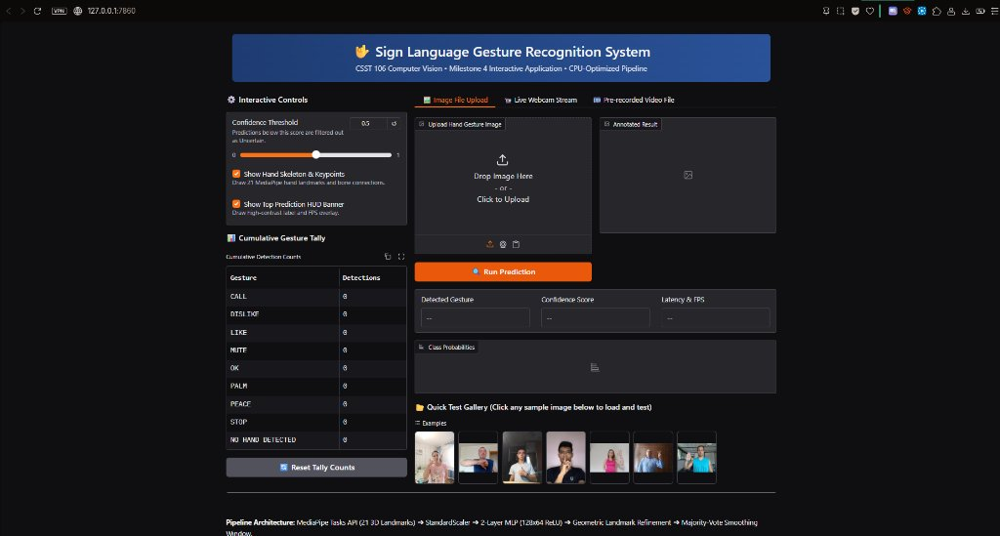
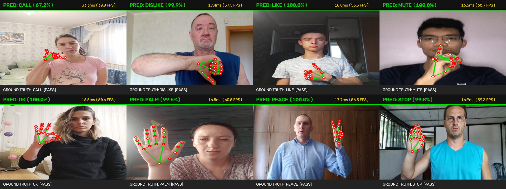

# Real-Time Sign Language Word Gesture Recognition and On-Screen Captioning

[](https://www.python.org/)
[](https://opencv.org/)
[](https://developers.google.com/mediapipe)
[](https://scikit-learn.org/)
[](#5-how-to-reproduce-the-results-table)
[](#8-team-and-contributions)
[](https://creativecommons.org/licenses/by/4.0/)

---

## 1. What It Does

This project provides a real-time, CPU-executed computer vision system that translates 8 static whole-word sign language gestures (`CALL`, `DISLIKE`, `LIKE`, `MUTE`, `OK`, `PALM`, `PEACE`, `STOP`) from live webcam streams, uploaded images, or video files into on-screen text captions to assist face-to-face communication between deaf or hard-of-hearing signers and non-signers. The pipeline extracts 21 3D hand skeletal landmarks via the MediaPipe Tasks API (`HandLandmarker`), isolates the active signing hand using highest-elevation selection (`num_hands=2`), classifies standardized 63-dimensional feature vectors with a 2-layer Multi-Layer Perceptron ($128 \times 64$ ReLU), applies scale-invariant geometric landmark refinement (thumb-index pinch ratio, inter-finger angular spread, and pinky separation), and stabilizes live output through a 5-frame temporal majority-vote queue. On the frozen 240-image unseen test set, the `v1.0` build achieves **86.25% end-to-end overall accuracy** (penalizing all detector dropouts), **93.67% accuracy on localized hands**, a **0.897 Macro-F1 score**, and an average inference latency of **18.98 ms per frame (52.7 FPS)** on a commodity laptop CPU without GPU acceleration.





---

## 2. Requirements

- **Operating System:** Windows 10/11 (64-bit), macOS, or Linux
- **Python Version:** Python 3.10 to 3.13
- **Hardware:** Standard laptop or desktop CPU (no discrete GPU required); standard USB or integrated RGB webcam for live streaming
- **Python Packages (`requirements.txt`):**
  - `opencv-python>=4.8.0`
  - `numpy>=1.24.0`
  - `matplotlib>=3.7.0`
  - `scikit-learn>=1.6.0`
  - `mediapipe>=0.10.0`
  - `gradio>=4.0.0`
  - `fastapi>=0.100.0`
  - `uvicorn>=0.23.0`
  - `pandas>=1.5.0`
  - `joblib>=1.2.0`

---

## 3. Installation

The `v1.0` repository includes the core trained weights (`models/best.pt`, `models/mediapipe_mlp_model.pkl`, `models/scaler_mp.pkl`, `models/hand_landmarker.task`) and the 240-image unseen test set (`data/test/`) directly in the repository so it runs immediately from a fresh clone:

```bash
# 1. Clone the repository and checkout the v1.0 release tag
git clone https://github.com/UmaliPrinceGenel/cv-sign-language-project.git
cd cv-sign-language-project
git checkout v1.0

# 2. (Optional) Create and activate a virtual environment
python -m venv venv
# Windows PowerShell:
.\venv\Scripts\Activate.ps1
# Windows CMD:
.\venv\Scripts\activate.bat
# macOS / Linux:
source venv/bin/activate

# 3. Install dependencies
pip install -r requirements.txt
```

---

## 4. How to Run the Application

### Option A: Interactive Web Application (Gradio + FastAPI MJPEG Stream)
Launch the full web interface supporting single-image uploads, built-in quick-test sample gallery, zero-lag 30 FPS HTTP MJPEG live webcam streaming, batch `.mp4` video processing, confidence threshold slider, skeleton overlay toggle, and cumulative gesture detection tally:

```bash
python src/app.py
```

- Open **`http://127.0.0.1:7860`** in your browser.
- If port `7860` is already in use, `src/app.py` automatically selects the next available port (e.g., `7861`) and prints the active URL in the terminal.
- You may also specify a custom port: `python src/app.py --port 7865`.

### Option B: Standalone Desktop OpenCV HUD Window
Launch the native OpenCV desktop application using asynchronous Windows Media Foundation (`cv2.CAP_MSMF`) camera capture with top prediction HUD and bottom cumulative tally bar:

```bash
# Live webcam stream (camera index 0)
python src/run.py --webcam 0

# Single image or directory batch inference
python src/run.py --input data/peace_01.jpg --save
```
- Press `q` or `ESC` inside the OpenCV window to exit cleanly.

---

## 5. How to Reproduce the Results Table

Run the single evaluation command from the project root directory to evaluate the frozen 240-image unseen test split (`data/test/`):

```bash
python src/evaluate.py --split test --weights models/best.pt
```

This command:
1. Evaluates all 240 unseen test images end-to-end (30 images per class across `call`, `dislike`, `like`, `mute`, `ok`, `palm`, `peace`, `stop`), strictly penalizing any `no_hand` detector dropouts as misclassifications.
2. Prints the per-frame latency, throughput (FPS), overall accuracy, Macro-F1 score, and `scikit-learn` classification report (`digits=3`).
3. Saves machine-readable metrics to [`outputs/eval/metrics.json`](outputs/eval/metrics.json) and the confusion matrix to [`outputs/eval/confusion_matrix.png`](outputs/eval/confusion_matrix.png) (mirrored in [`outputs/final/`](outputs/final/)).

### Reproduced Results Table (Baseline vs. Milestone 3 vs. Final `v1.0`)

| Evaluation Dimension | MS2 Baseline (`cp2-50`) | MS3 Core (`cp3-core`) | Final Build (`v1.0`) | Net Change (MS3 to `v1.0`) |
| :--- | :---: | :---: | :---: | :---: |
| **Pipeline Architecture** | YCrCb + Hu + HOG + SVM | MediaPipe (`num_hands=1`) + MLP | **MediaPipe (`num_hands=2`) + MLP + Geometry** | Active Hand + Geometry |
| **Unseen Full-Scene Test Accuracy** | < 30.0% (clutter failure) | 73.86% (178 / 241) | **86.25% (207 / 240)** | **+12.39% Accuracy** |
| **Unseen Test Macro-F1 Score** | 0.284 (full scene) | 0.778 | **0.897** | **+0.119 Macro-F1** |
| **Accuracy on Localized Hands** | 96.25% (cropped ROI only) | 82.71% (177 / 214) | **93.67% (207 / 221)** | **+10.96% Visible Acc** |
| **Detector Dropouts (`no_hand`)** | N/A (segments largest blob) | 27 / 241 (11.2%) | **19 / 240 (7.9%)** | **-30% Dropouts** |
| **CPU Inference Latency / Speed** | 6.09 ms (164.3 FPS ROI) | 21.18 ms (47.2 FPS) | **18.98 ms (52.7 FPS)** | **-2.20 ms (+5.5 FPS)** |

### Reproduced Per-Class Test Metrics (`v1.0`, 240 Unseen Test Images)

| Class | Precision | Recall | F1-Score | Support |
| :--- | :---: | :---: | :---: | :---: |
| **`call`** | 0.958 | 0.767 | **0.852** | 30 |
| **`dislike`** | 0.931 | 0.900 | **0.915** | 30 |
| **`like`** | 0.862 | 0.833 | **0.847** | 30 |
| **`mute`** | 0.917 | 0.733 | **0.815** | 30 |
| **`ok`** | 0.966 | 0.933 | **0.949** | 30 |
| **`palm`** | 0.964 | 0.900 | **0.931** | 30 |
| **`peace`** | 0.967 | 0.967 | **0.967** | 30 |
| **`stop`** | 0.929 | 0.867 | **0.897** | 30 |
| **Macro Avg / Total** | **0.937** | **0.863** | **0.897** | **240 (86.25% Acc)** |

---

## 6. Where the Dataset and Weights Are Located

### Model Weights (`models/`)
- **Included in Repository & GitHub Release (`v1.0`):**
  - `models/best.pt` (599.4 KB) and `models/mediapipe_mlp_model.pkl` (599.4 KB): Trained 2-layer MLP classifier weights ($63 \rightarrow 128 \rightarrow 64 \rightarrow 8$).
  - `models/scaler_mp.pkl` (2.1 KB): Fitted `StandardScaler` for 63-D MediaPipe landmarks.
  - `models/hand_landmarker.task` (7.45 MB): MediaPipe Tasks API HandLandmarker TFLite model asset (also auto-downloads from Google Cloud Storage if absent).
  - `models/scaler.pkl` (42.2 KB): Fitted `StandardScaler` for the Milestone 2 HOG + SVM baseline.
- **External Archive (Full Weights Bundle including 23.3 MB `svm_baseline_model.pkl`):**
  - [Google Drive Model Weights Folder](https://drive.google.com/drive/folders/1y-HSH_zvyWyW8_Z57QIqf8QoLx51tEPz?usp=sharing) and attached to the GitHub `v1.0` Release.

### Dataset (`data/`)
- **Included in Repository:**
  - `data/test/`: All **240 unseen test images** (30 per class across all 8 classes) used by `src/evaluate.py`.
  - `data/*.jpg`: 20 quick-test sample images (`call_01.jpg` to `stop_02.jpg`, plus out-of-vocabulary `fist_01.jpg` and `rock_01.jpg`).
- **Full 1,600-Image Dataset Source & Documentation:**
  - Sourced from the [HaGRID Sample 30k 384p Dataset on Kaggle](https://www.kaggle.com/datasets/innominate817/hagrid-sample-30k-384p) under the **CC BY 4.0** license (1,120 train / 240 val / 240 test). Full provenance and preprocessing details are documented in [`docs/datacard.md`](docs/datacard.md).

---

## 7. Project Structure

```text
cv-sign-language-project/
├── README.md                          # Project overview, installation, usage & reproduction guide
├── requirements.txt                   # Python package dependencies
├── data/
│   ├── *.jpg                          # 20 quick-test & out-of-vocabulary sample images
│   └── test/                          # Frozen 240-image unseen test set (30 images x 8 classes)
│       ├── call/
│       ├── dislike/
│       ├── like/
│       ├── mute/
│       ├── ok/
│       ├── palm/
│       ├── peace/
│       └── stop/
├── docs/
│   ├── Final_report.pdf               # Milestone 5 Final Project Report PDF (10 sections + appendices)
│   ├── test_cases.md                  # Formal 10-case test matrix (TC01-TC10, including 3 hard cases)
│   ├── datacard.md                    # Dataset provenance, CC BY 4.0 license & 70/15/15 split details
│   ├── ms4_report.md                  # Milestone 4 (cp4-80) technical report
│   ├── ms3_report.pdf                 # Milestone 3 (cp3-core) results & error analysis PDF
│   ├── progress_report.md             # Milestone 2 (cp2-50) baseline progress report
│   └── Project_Outline_CV.pdf         # Milestone 1 (cp1-proposal) project outline
├── models/
│   ├── best.pt                        # Final production MLP classifier weights (599.4 KB)
│   ├── mediapipe_mlp_model.pkl        # Serialized MLP classifier artifact
│   ├── scaler_mp.pkl                  # StandardScaler fitted on 63-D training landmarks
│   ├── hand_landmarker.task           # MediaPipe Tasks API HandLandmarker model
│   └── scaler.pkl                     # StandardScaler for Milestone 2 classical baseline
├── notebooks/
│   └── CV_project_sign.ipynb          # Dataset exploration, feature extraction & model training notebook
├── outputs/
│   ├── contact_sheet.png              # Milestone 1 20-sample labeled dataset contact sheet
│   ├── ms3_confusion_matrix.png       # Milestone 3 confusion matrix archive
│   ├── eval/                          # Live output directory for src/evaluate.py
│   │   ├── confusion_matrix.png
│   │   └── metrics.json
│   ├── failures/                      # Milestone 3 10-image annotated failure gallery
│   └── final/                         # Milestone 5 final screenshots, 8-class grid & failure outputs
│       ├── confusion_matrix.png
│       ├── final_8class_grid.png
│       ├── final_failures_grid.png
│       ├── ui_gradio_screenshot.jpg
│       ├── sample_01_call.jpg ... sample_08_stop.jpg
│       └── failure_TC07_...jpg ... failure_TC09_...jpg
└── src/
    ├── app.py                         # FastAPI + Gradio interactive web app with MJPEG webcam stream
    ├── run.py                         # Core 4-stage pipeline, geometric refinement & OpenCV desktop HUD
    ├── evaluate.py                    # Reproducible test-split benchmark & confusion matrix script
    ├── baseline.py                    # Milestone 2 classical YCrCb + Hu Moments + HOG + SVM pipeline
    ├── predict.py                     # Milestone 2 classical single-image inference prototype
    ├── generate_failures.py           # Automated mismatch hunter and skeleton failure annotator
    └── spike.py                       # Milestone 1 feasibility spike and image processing script
```

---

## 8. Team and Contributions

**Course:** CSST 106 — Computer Vision Final Project

| Team Member (Git Author) | Modules Owned | Concrete Technical Contributions | Git Commits |
| :--- | :--- | :--- | :--- |
| **Prince Genel Umali** (`Prince Genel Umali` / `Prinz`) | `src/baseline.py`, `src/predict.py`, `src/generate_failures.py`, `notebooks/CV_project_sign.ipynb`, `docs/ms3_report.pdf`, `requirements.txt` | Implemented Milestone 2 classical baseline (YCrCb skin segmentation, Hu moments, HOG, SVM); trained Milestone 3 MediaPipe + MLP classifier weights; created automated failure gallery generator (`outputs/failures/`); authored MS3 report PDF and initial repository setup. | `e604dde`, `1ccc86c`, `977d4a7`, `f31ee35`, `37a0a14`, `aa99dd1`, `fc7768e` |
| **Kean Gabriel Salvahan** (`Kean`) | `src/app.py`, `src/run.py`, `src/evaluate.py`, `src/spike.py`, `models/best.pt`, `docs/Final_report.pdf`, `docs/test_cases.md`, `README.md` | Implemented Milestone 1 feasibility spike and contact sheet; engineered scale-invariant geometric landmark refinement (`OK`/`PALM`/`STOP`/`CALL`) and `num_hands=2` active-hand selection; built FastAPI + Gradio web app with native MJPEG streaming and auto-port fallback; standardized `src/evaluate.py` and Milestone 4/5 reports. | `8ba444f`, `1770621`, `0ef8627`, `9fe47c6`, `a733b70`, `8daeb04`, `4918227`, `59745c9` |
| **Justin Angelo Luzande** (`Justin Angelo Luzande`) | `data/*.jpg`, `data/test/`, `src/run.py` (live HUD testing), `docs/datacard.md` | Collected and curated local multi-class gesture validation/test image samples across all 8 target gestures plus out-of-vocabulary negative samples (`fist`, `rock`); verified stratified dataset splits and conducted live webcam HUD verification. | `dc587a2`, `e990edc`, `4229391`, `8b7258c` |
