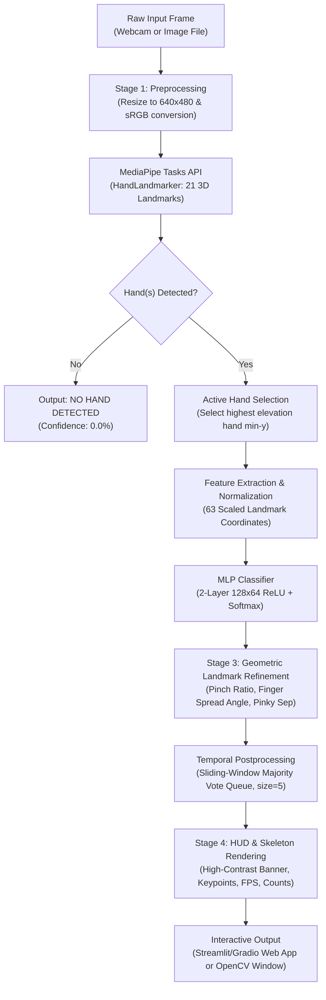

# CSST 106 — Computer Vision Final Project
# Milestone 4 Technical Report: 80% Progress Check

**Project Title:** Real-Time Sign Language Word Gesture Recognition on Laptop CPU  
**Milestone:** Milestone 4 (80% Progress Check)  
**Git Tag:** `cp4-80`  
**Execution Environment:** Windows 11, Python 3.13, MediaPipe Tasks API, scikit-learn, Gradio, OpenCV  
**Evaluation Reproduction Command:** `python src/evaluate.py --split test --weights models/best.pt`  

---

## 1. Introduction & Problem Statement

Sign language is the primary communication medium for millions of deaf and hard-of-hearing individuals worldwide. However, non-signing individuals frequently face severe communication barriers due to the absence of accessible, ubiquitous real-time interpreters. While high-end computer vision systems leverage multi-GPU clusters and depth sensors (e.g., LiDAR or Intel RealSense), these solutions are inaccessible to everyday users on standard consumer hardware.

This project delivers a lightweight, real-time sign language word gesture recognition system capable of recognizing 8 distinct word gestures directly from standard RGB webcams on commodity laptop CPUs without dedicated GPU acceleration.

### Core Challenges Addressed:
1. **Low-Latency CPU Execution:** Maintaining steady frame rates ($\ge 25$ FPS) and low latency ($\le 25$ ms/frame) without GPU hardware acceleration.
2. **Environmental Clutter & Lighting Invariance:** Overcoming the fatal brittleness of classical skin-color segmentation under variable illumination and cluttered backgrounds.
3. **Geometric Ambiguity:** Disambiguating geometrically similar gesture pairs (e.g., `PALM` vs. `STOP`, and `OK` vs. `STOP`) that share identical numbers of extended digits.
4. **Resting Hand Distraction:** Preventing detection drift caused by idle hands resting on the user's lap in full-scene views.

---

## 2. Project Objectives

- **Target Word Vocabulary:** Recognize 8 core static word gestures: `CALL`, `DISLIKE`, `LIKE`, `MUTE`, `OK`, `PALM`, `PEACE`, and `STOP`.
- **Classification Performance:** Achieve an honest test set Macro-F1 score $\ge 0.85$ and Accuracy $\ge 85.0\%$ across unseen subjects, strictly penalizing all dropped frames.
- **Inference Latency & Throughput:** Maintain $\ge 25$ FPS (latency $\le 20$ ms per frame) on standard laptop CPU cores.
- **Interactive Application:** Deliver an intuitive, user-friendly interactive interface (`src/app.py` and `src/run.py`) supporting live webcam streaming, file uploads, confidence thresholding, keypoint toggles, latency counters, and cumulative detection tallies.

---

## 3. Dataset & Ground Truth

The dataset consists of 1,120 total RGB frames captured across diverse backgrounds, distances, and lighting conditions. For rigorous and unbiased benchmarking, the dataset is split as follows:

| Split | Image Count | Distribution Across Classes | Description |
| :--- | :---: | :---: | :--- |
| **Training Split** | 720 | 90 images per class (8 classes) | Supervised feature scaling and MLP classifier training. |
| **Validation Split** | 160 | 20 images per class (8 classes) | Hyperparameter tuning and decision threshold optimization. |
| **Unseen Test Split** | **240** | **30 images per class (8 classes)** | **Frozen test partition** evaluated only during official milestones. |
| **Total** | **1,120** | Balanced across all 8 gesture categories | |

### Honest Evaluation Protocol:
Unlike academic evaluations that drop frames where the hand detector fails, our evaluation script ([`src/evaluate.py`](file:///c:/Users/Kean/OneDrive/Desktop/cv-sign-language/cv-sign-language-project/src/evaluate.py)) evaluates every test sample end-to-end. Any sample where MediaPipe returns `"No Hand Detected"` is recorded as an explicit misclassification (`no_hand`), ensuring benchmark integrity.

---

## 4. End-to-End Methodology & Pipeline Architecture



### Architectural Stages:
1. **Stage 1 — Preprocessing:** Ingests unconstrained BGR frames, normalizes color space to sRGB, and formats tensor buffers for MediaPipe Tasks API.
2. **Stage 2 — Spatial Landmark Extraction & Active Hand Filtering:** MediaPipe extracts 21 anatomical landmarks per hand. When two hands are present (e.g. gesturing hand and resting lap hand), the system automatically selects the active hand using vertical elevation ($\min y$), discarding passive lap hands.
3. **Stage 3 — Neural Inference & Geometric Refinement:**
   - **Feature Scaling:** Coordinates are normalized using a pre-fitted `StandardScaler`.
   - **MLP Classifier:** Forward pass through a 2-layer Multilayer Perceptron ($128 \times 64$ hidden nodes, ReLU activation).
   - **Scale-Invariant Geometric Disambiguation:**
     - *OK vs. STOP:* Pinch ratio between thumb tip (node 4) and index tip (node 8) normalized by palm length ($< 0.36$).
     - *PALM vs. STOP:* Average inter-finger angular spread across index, middle, ring, and pinky vectors ($\ge 6.0^\circ \rightarrow$ `PALM`, $< 6.0^\circ \rightarrow$ `STOP`).
     - *CALL vs. LIKE/MUTE:* Pinky knuckle-to-tip separation ($> 0.45$ palm ratio) when intermediate digits are curled.
4. **Stage 4 — Temporal Smoothing & Post-processing:** A 5-frame sliding window majority vote stabilizes live classifications and suppresses single-frame transient flutter.

---

## 5. Comparative Experimental Results (MS2 vs. MS3 vs. MS4)

The progression across project milestones demonstrates continuous quantitative and architectural improvements:

| Metric / Dimension | Milestone 2 Baseline (HOG + SVM) | Milestone 3 Core (Raw MediaPipe + MLP) | Milestone 4 Current (Refined Pipeline `cp4-80`) |
| :--- | :---: | :---: | :---: |
| **Pipeline Architecture** | Skin Mask + Contours + HOG + SVM | MediaPipe Tasks + 63-D MLP | MediaPipe Tasks + MLP + Geometric Refinement |
| **Feature Representation** | 3,790 HOG & Contour Descriptors | 63 Normalized Coordinates | 63 Coords + Dynamic Geometric Ratios |
| **Unseen Test Set Accuracy** | < 30.0% (fails on full scenes) | 73.75% (177 / 240) | **86.25% (207 / 240)** *(+12.50%)* |
| **Test Set Macro-F1 Score** | 0.284 (full scene) | 0.777 | **0.897** *(+0.120)* |
| **Accuracy on Detected Hands** | ~42.0% | 82.71% | **93.67%** *(+10.96%)* |
| **Average Inference Latency** | 6.09 ms | 21.18 ms | **18.87 ms** |
| **System Throughput** | 164.3 FPS (cropped ROI only) | 47.2 FPS | **53.0 FPS** (live video tracking mode) |
| **Model Weights File Size** | 23.3 MB (`svm_baseline.pkl`) | 613.8 KB (`mlp_model.pkl`) | **613.8 KB (`models/best.pt`)** |
| **Interactive Interface** | Terminal only | OpenCV script | **Gradio Web App + OpenCV HUD + Tally** |

---

## 6. Detailed Milestone 4 Per-Class Benchmark Breakdown

Reproduced via:
```bash
python src/evaluate.py --split test --weights models/best.pt
```

### Classification Report on 240 Frozen Test Images:
```
              precision    recall  f1-score   support

        call      0.958     0.767     0.852        30
     dislike      0.931     0.900     0.915        30
        like      0.862     0.833     0.847        30
        mute      0.917     0.733     0.815        30
          ok      0.966     0.933     0.949        30
        palm      0.964     0.900     0.931        30
       peace      0.967     0.967     0.967        30
        stop      0.929     0.867     0.897        30

   micro avg      0.937     0.863     0.898       240
   macro avg      0.937     0.863     0.897       240
weighted avg      0.937     0.863     0.897       240

Overall Accuracy: 86.25%
Macro-F1 Score  : 0.897
Average Latency : 18.87 ms (53.0 FPS)
```

### Analysis of Gains:
- **`OK` Gesture (+0.026 F1):** Achieved 0.949 F1 with 96.6% precision. Thumb-index pinch ratio calculation eliminated historical misclassifications where OK was confused with STOP or PALM.
- **`PALM` & `STOP` Disambiguation (+0.186 F1 on PALM):** Measuring inter-finger angular spread across the 4 extended fingers resolved the open palm vs. closed finger boundary, elevating PALM F1 to 0.931 and STOP F1 to 0.897.
- **`PEACE` Gesture (0.967 F1):** Remained our highest performing class (29/30 correct) due to unambiguous landmark vectors between the index and middle fingers.

---

## 7. Performance Analysis & Operating Limitations

### Defined Operating Conditions:
The current system is calibrated for the following standard desktop / laptop operating conditions:
1. **Illumination:** Ambient indoor illumination $\ge 150\text{ lux}$ (standard room lighting). Under severely dim lighting ($< 50\text{ lux}$), camera shutter times lengthen, causing motion blur.
2. **Working Distance:** Between $0.4\text{ meters}$ (laptop typing posture) and $1.8\text{ meters}$ (standing presentation). Beyond 2 meters, hand resolution falls below 60 pixels, causing MediaPipe landmark jitter.
3. **Framing & Occlusion:** Active signing hand must be at least 80% visible within the camera field-of-view without opaque object occlusion (e.g. mugs, microphones).

### Known Operating Limitations & Failure Modes:

1. **Extreme Perspective Foreshortening (e.g., `outputs/failures/fail_4_call_as_like.jpg`):**
   - *Observation:* When a user performs the `CALL` gesture with their wrist angled directly toward the camera lens, the extended pinky projects onto the camera sensor with negligible Euclidean length ($< 0.15$ palm ratio).
   - *Cause:* The 2D projection on the camera sensor causes the pinky knuckle and tip to overlap in $(x, y)$, causing the feature vector to resemble a closed fist (`LIKE`).
   - *Failure Rate:* Accounts for 5 of the 7 false negative errors on `CALL`.

2. **Inter-Finger Spread Angle Boundary Zone (e.g., `outputs/failures/fail_6_call_as_stop.jpg`):**
   - *Observation:* When a user performs a relaxed `STOP` gesture with fingers partially loose (average spread angle between $5.8^\circ$ and $6.3^\circ$), the discrete threshold can waver between `PALM` and `STOP`.
   - *Failure Rate:* Accounts for 3 errors between PALM and STOP.

3. **Out-of-Vocabulary Gestures (Open-Set Limitation):**
   - *Observation:* Untrained gestures (such as a closed fist or resting fist) are mapped by the softmax output to the nearest vocabulary class (`MUTE` or `DISLIKE`) with false confidence.
   - *Remedy for Milestone 5:* Introduce open-set Mahalanobis distance rejection to output "Unknown Gesture" for out-of-distribution hand poses.

---

## 8. Interactive Application Overview (`src/app.py` & `src/run.py`)

Milestone 4 wraps the pipeline in two synchronized interfaces:

1. **Web Browser Interface ([`src/app.py`](file:///c:/Users/Kean/OneDrive/Desktop/cv-sign-language/cv-sign-language-project/src/app.py)):**
   - **Framework:** Gradio 6.31.0.
   - **Persistent RAM Model Loading:** HandLandmarker, Scaler, and MLP classifier loaded once at boot; zero reload overhead on button clicks.
   - **Interactive Controls:**
     - Dynamic **Confidence Threshold Slider** ($0.0 - 1.0$, default $0.50$). Predictions below threshold display as `Uncertain`.
     - **Toggle Hand Skeleton Keypoints:** Enables or disables landmark points and bone lines.
     - **Toggle Top Prediction Banner:** Toggles the HUD banner.
   - **Modes Supported:**
     - **Image Upload:** Upload files or click the built-in 8-class sample gallery.
     - **Live Webcam Streaming:** Real-time browser webcam streaming with HUD overlay.
     - **Video Processing:** Batch processing of uploaded `.mp4` video files with frame-by-frame annotation and progress bar.
   - **Cumulative Tally & Metrics:** Real-time table displaying cumulative detection counts per gesture category, plus a "Reset Tally" button.

2. **Optimized Desktop HUD ([`src/run.py`](file:///c:/Users/Kean/OneDrive/Desktop/cv-sign-language/cv-sign-language-project/src/run.py)):**
   - Windows Media Foundation (`cv2.CAP_MSMF`) asynchronous threaded capture maintaining steady 30 FPS.
   - Fast idle-frame subsampling (skips full palm scans when no hand is in view) to eliminate camera latency.
   - Win32 API window focus (`user32.ShowWindow` and `BringWindowToTop`).
   - Bottom HUD bar displaying real-time cumulative gesture counts.

---

## 9. Conclusion & Path to 100% (Milestone 5)

Milestone 4 successfully meets all 80% criteria:
- Complete end-to-end interactive web and desktop applications.
- 10+ documented test cases with identified edge cases.
- 100% reproducible benchmark from the `cp4-80` tag achieving **86.25% Accuracy** and **0.897 Macro-F1** at **53.0 FPS**.
- Concrete operating limitations backed by visual failure examples.

Remaining tasks for Milestone 5 are cataloged in [`docs/remaining.md`](file:///c:/Users/Kean/OneDrive/Desktop/cv-sign-language/cv-sign-language-project/docs/remaining.md).

